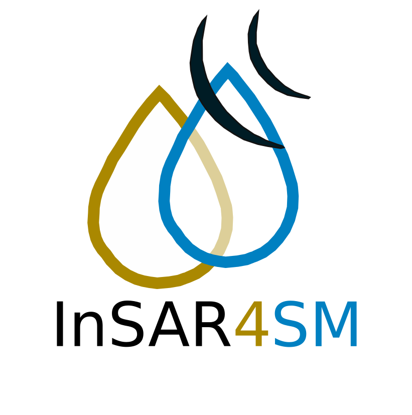
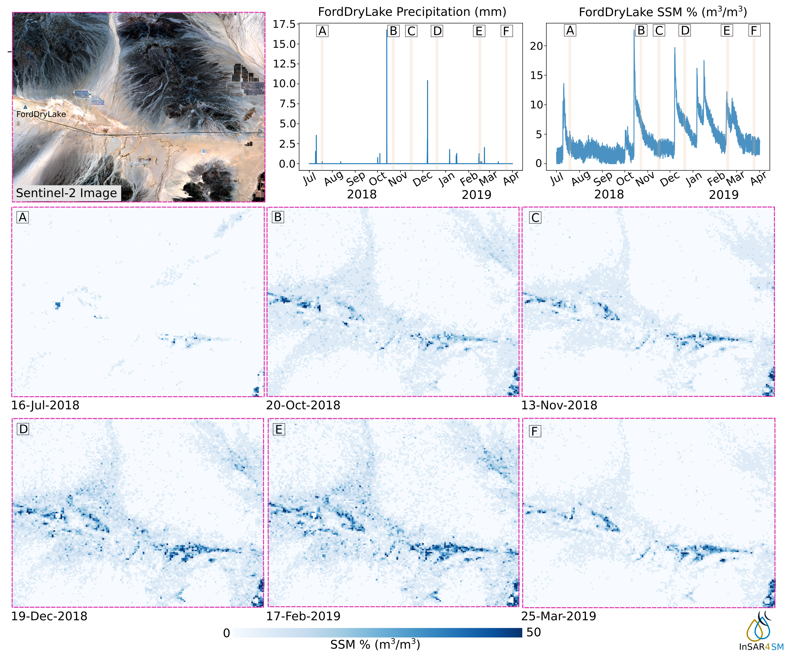

#  InSAR4SM - Interferometric Synthetic Aperture Radar for Soil Moisture

## Introduction

InSAR4SM is a free and open-source software for estimating soil moisture using interferometric observables over arid regions. 
It requires as inputs the following data:

- an area of interest (AOI) and a period. The SAR data are downloaded for the AOI only:
    - **NISAR** L2 GSLC (L-band, HH): only the AOI window of each granule is read remotely.
    - **Sentinel-1** (C-band, VV): single bursts (~150 MB each, global coverage) are geocoded on the AOI with [COMPASS](https://github.com/opera-adt/COMPASS), the OPERA CSLC-S1 processor.
  
  Every track that covers the AOI gives its own soil moisture time series. AOIs that cross Sentinel-1 bursts or NISAR frames are mosaicked. L-band senses a deeper soil layer (~5 cm) than C-band (~1-2 cm), so the two sensors are not expected to agree exactly.
- a meteorological dataset (e.g. from [ERA5-Land](https://cds.climate.copernicus.eu/cdsapp#!/dataset/reanalysis-era5-land?tab=overview) data)
- a soil texture dataset (sand and clay) for your region of interest (e.g. from [soilgrids](https://soilgrids.org/))

A [NASA Earthdata](https://urs.earthdata.nasa.gov) account is needed for the SAR data. ISCE2 Topstack stacks are no longer supported (use a release before this change for that workflow).

For each SAR acquisition a surface soil moisture map is provided.

This is research code provided to you "as is" with NO WARRANTIES OF CORRECTNESS. Use at your own risk.



## 1. Installation
The installation notes below are tested only on Linux. The local Sentinel-1 geocoding (isce3/COMPASS) needs Linux; on Windows use [WSL2](https://learn.microsoft.com/windows/wsl/install) (`wsl --install -d Ubuntu`) and run everything inside it.

### 1.1 Download InSAR4SM
First you have to download InSAR4SM using the following command

```git clone https://github.com/kleok/InSAR4SM.git```

### 1.2 Create python environment for InSAR4SM

InSAR4SM is written in Python3 and relies on several Python modules. Two environments are provided:

| Environment file | Name | Use it for |
|---|---|---|
| `INSAR4SM_env.yml` | `insar4sm` | NISAR GSLC and Sentinel-1 **OPERA CSLC-S1** (North America). No isce3. |
| `INSAR4SM_env_compass.yml` | `insar4sm_compass` | Everything above, plus local Sentinel-1 geocoding with COMPASS/isce3 (**global** coverage, Linux only). |

```conda env create -f INSAR4SM_env.yml```

Exact, tested package versions for Linux are in the lock files (`conda create -n insar4sm --file conda-linux-64.lock`, or `conda-compass-linux-64.lock` for the COMPASS environment).

Sentinel-1 sources (`s1_source` in the notebook):
- `'OPERA'`: [OPERA CSLC-S1](https://www.jpl.nasa.gov/go/opera/products/cslc-product-suite/) bursts already geocoded by JPL; only the AOI window is read. North America only.
- `'COMPASS'`: single Sentinel-1 bursts downloaded from ASF and geocoded locally on the AOI with [COMPASS](https://github.com/opera-adt/COMPASS). Global.

### 1.3 Run the tests (optional)

```
conda activate insar4sm
pytest tests/
```

`tests/smoke/run_ford_dry_lake.py` runs a short end-to-end case at the Ford Dry Lake SCAN station (California), compared with ISMN in-situ soil moisture.

### Case study

[**Ford Dry Lake, California (Nov 2025 – Nov 2026)**](case_studies/FordDryLake/): one year of NISAR and Sentinel-1 soil moisture compared with in-situ data. InSAR4SM reaches 1.7 % RMSE (R 0.90), against 4.0 % (R 0.84) for ERA5-Land, with an estimate every ~2 days at 125 m spacing. The folder has a [PDF report](case_studies/FordDryLake/FordDryLake_case_study.pdf) and a [notebook](case_studies/FordDryLake/FordDryLake_case_study.ipynb).

### 1.4 Set environmental variables (optional)
on GNU/Linux, append to .bashrc file:
```
export InSAR4SM_HOME=~/InSAR4SM
export PYTHONPATH=${PYTHONPATH}:${InSAR4SM_HOME}
export PATH=${PATH}:${InSAR4SM_HOME}
```

## 2. Running InSAR4SM

InSAR4SM provide soil moisture estimations using interferometric observables, meteorological and soil texture data from the following pipeline. 
- Download of the SAR data over the AOI and one geocoded SLC stack per track (removal of acquisitions with frozen soil).
- Identification of driest SAR image based on meteorological information.
- Calculation of interferometric observables (coherence and phase closure).
- Identification of SAR acquisitions related to dry soil moisture conditions using coherence and amplitude information.
- Calculation of coherence information due to soil moisture variations.
- Soil moisture inversion using De Zan`s model.

Please start with the jupyter notebook example [here](INSAR4SM_app.ipynb)

## 3. Documentation and citation
Algorithms implemented in the software are described in detail at our publication. If InSAR4SM was useful for you, we encourage you to cite the following work.

- Karamvasis, K., & Karathanassi, V. (2023). Soil moisture estimation from Sentinel-1 interferometric observations over arid regions. Computers & Geosciences, 178, 105410. [here](https://doi.org/10.1016/j.cageo.2023.105410)

For the NISAR (L-band) work, please also cite:

- Katsamas, G., Karamvasis, K., & Karathanassi, V. (2026). Toward Improved Soil Moisture Retrieval Using NISAR InSAR Closure Phase Measurements. EARSeL Symposium, Athens. [PDF](https://drive.google.com/file/d/1nKk2JU313nhIxNLPmR2ZAa3G-Cnvtlm3/view?usp=drive_link)

## 4. Contributors
- **Kleanthis Karamvasis**: author and maintainer.
- **Giorgos Katsamas** ([@GiorgosKatsamas](https://github.com/GiorgosKatsamas)): NISAR GSLC and Sentinel-1 geocoded-SLC workflow, ERA5-Land improvements and model fixes ([#14](https://github.com/kleok/INSAR4SM/pull/14)). Thank you, Giorgos!

## 5. Acknowledgements
<a href="https://github.com/moistx-labs"></a>

The development of InSAR4SM is supported by [moistX](https://github.com/moistx-labs).

## 6. Contact us
Feel free to open an issue, comment or pull request. We would like to listen to your thoughts and your recommendations. Any help is very welcome!
